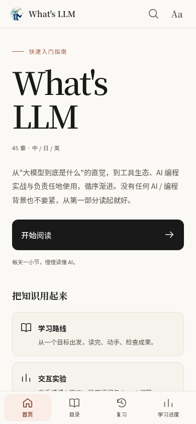
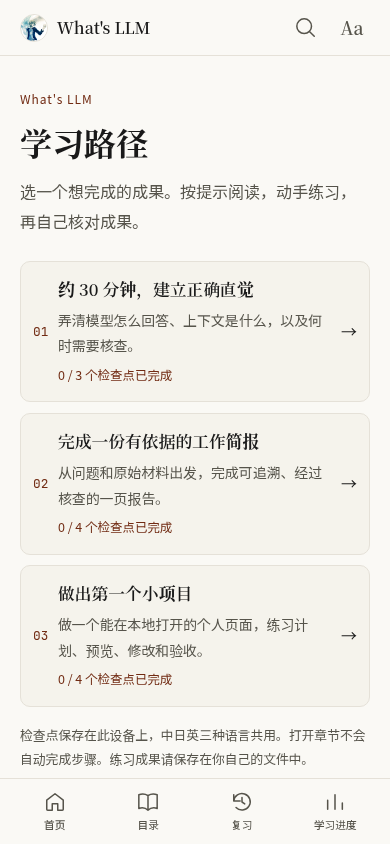
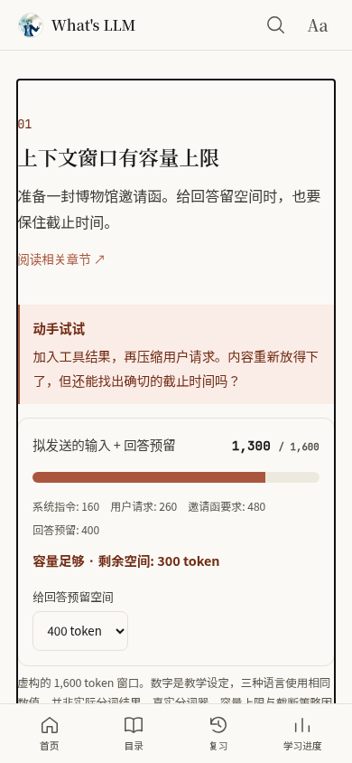
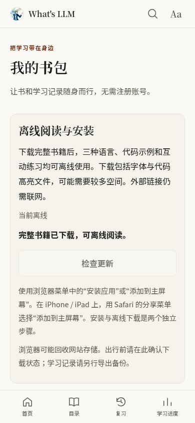
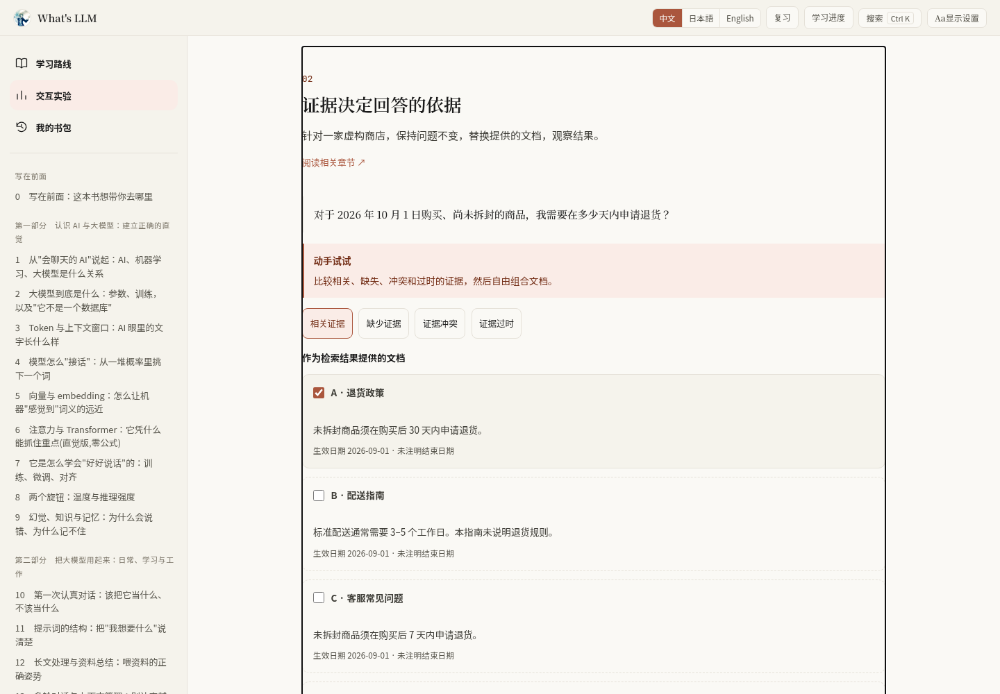

# 2026-10-22：从阅读到实践

本轮把六项改进接入现有中英日三语阅读器，继续使用米白纸感、暖色点缀和手机底部导航。首页与目录顶部提供三个新入口。

## 学习路线`/learn/`

三条路线分别完成概念入门、带来源的工作报告和第一个本地网页项目。每一步给出选读章节、动手任务、成果要求与自检标准；读者主动勾选检查点，进度保存在本机。切换语言共享同一条路线的完成情况。访问章节本身不会自动完成实践任务。

详见[路线设计与保存方式](learning-paths.md)。

## 交互实验`/labs/`

- 上下文预算：加入任务、材料和工具结果，为输出留出空间；压缩会明确丢失部分事实。
- RAG证据：选择相关、过期、缺失或冲突的资料，观察回答依据、引用和暂缓判断。
- Agent权限：逐项开放模拟操作权限，查看阻止原因、操作记录和撤销结果。

实验使用固定场景和本地规则，明确标注为教学模拟。无需API，不执行真实命令，不把模拟结果描述成模型实测。相关章节末尾有直达实验的链接。详见[交互实验说明](labs.md)。

## 我的书包`/library/`

正式网页版可主动下载整本书，缓存全部三语正文、字体、代码高亮和交互功能。全部资源校验完成后才显示离线就绪。新版本先下载，再由读者应用；保留上一份完整缓存作为恢复依据。外部来源链接仍需要联网。

PWA需要HTTPS或localhost；开发服务器与Tauri中不注册服务工作线程。支持安装提示的浏览器会显示安装按钮，其他浏览器提供菜单操作说明。部署与更新行为见 [PWA指南](pwa.md)。这不等同于原生iOS/Android安装包。

书包也提供版本化JSON备份，包含：

- 三语笔记与高亮，及其编辑时间；
- 全部学习卡片、历史复习事件、已读章节，包括已退役题目记录；
- 按语言保存的最近章节、段落位置、学习路线检查点；
- 语言、主题和字号设置。

导入先验证整个文件并预览数量，再合并。较新的笔记、卡片和阅读位置优先；时间相同保留本机版本；已读章节和检查点取并集；本机已有显示设置优先。重复导入同一文件不会增加重复事件。导入前提供恢复备份，写入失败会尝试回滚并保留原始恢复数据。

浏览器通过localStorage保存；桌面学习数据通过SQLite事务导入，笔记保留已有的文件与本地恢复机制。浏览器的简化复习调度和桌面的FSRS仍不同，迁移会保留已有状态，后续复习由目标平台的调度器安排。没有账号系统或自动云同步。

文件格式、合并规则与恢复步骤见[学习数据备份指南](portable-learning-data.md)。

## 阅读位置与测验

段落续读使用文字锚点与段内相对位置，适应屏幕宽度和字号变化；正文改动使锚点消失时，退回整章进度。每种语言单独记录。指定章节锚点的链接优先；首次阅读一种语言从章首开始。

题目使用显式稳定编号、内容修订及评分内容标识。现有615道可评分题目的身份保留：措辞修订不会丢失记录，选项或正确答案变化会生成新的评分身份，旧历史继续保留。复习页支持到期复习与错题练习，可按主题和章节筛选。原“记忆保持率”更名为反映实际计算方式的历史答题正确率。维护方式见[测验维护指南](quiz-maintenance.md)。

## 内容长期维护

每章末尾可展开版本、编辑核对、来源和翻译对应关系。45章、135份文本都登记了内容哈希；产品操作与基础概念分别使用90天和365天的建议复核周期。日期沿用真实的编辑记录，未单独核验的外部来源明确留空。

日常CI检查未确认的正文变化、缺少的翻译和版本对齐。另一个每周工作流报告到期章节，并保存外部链接可达性报告。可达性只说明能否访问，不代表事实已核验。此次代理网络检查的44个唯一来源/快照链接中，33个可访问，11个无法确认网络访问；没有因此自动更新任何来源核实日期。

详见[内容维护指南](content-maintenance.md)。

## 验证方式

2026-10-22最终验证：Svelte检查零错误、零警告；135份章节元数据和720道题目的登记检查通过；263项单元测试、42项生产预览浏览器测试、3项真实构建PWA测试及19项Rust核心测试通过。生产构建成功。三种语言的7个主要页面在320px宽、150%字号下共21组布局检查无页面横向溢出和脚本异常。

独立复查发现并修复了跨版本离线缓存混用、并发下载缓存清理、失败导入后的恢复文件、未保存笔记导出、未知阅读记录校验及测验措辞更新回归等问题。生产预览现在直接提供静态构建文件，可以在本地验证离线下载和重载。

历史自动测试不再随公开源码分发。当前构建与验证命令见[项目README](../README.md)。

Chromium手机视口验证不能替代真实Safari/iOS/Android的安装菜单、键盘、选择手柄和系统存储回收测试；桌面安装包也需要对应平台的原生验收。

## 实际预览

下图来自正式构建。手机视口为390 × 844；书包截图在下载完整书籍后断网重载取得。

| 首页 | 学习路线 |
| --- | --- |
|  |  |

| 上下文实验 | 实践检查点 |
| --- | --- |
|  |  |

| 离线书包 |
| --- |
|  |

桌面视口为1440 × 1000：

