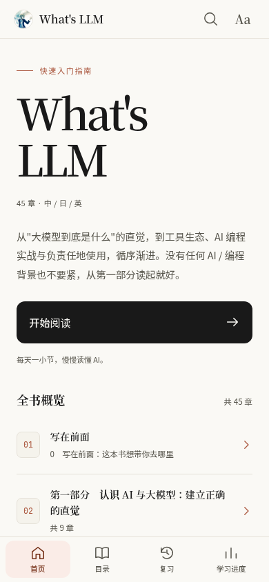
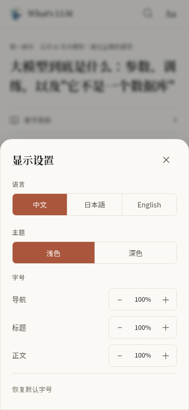
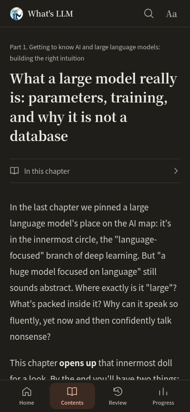

# 手机阅读版 · 2026-10-22

本页保留第一轮手机阅读改版的截图与验证记录。后续已加入段落续读、学习路线、交互实验、离线安装和数据备份，查看[最新功能、截图与验证](learning-book.md)。

这轮将现有阅读器做成可实际使用的响应式网页，采用米白书页、暖陶色、衬线标题和舒展行距。手机、平板和桌面共用同一套三语内容；App 封装留待平台选型后处理。

## 实际界面

下图来自生产构建的 Chromium 手机视口（390 × 844），使用真实章节与全新学习记录。

| 首页 | 章节阅读 |
| --- | --- |
|  |  |

| 阅读设置 | 英文深色阅读 |
| --- | --- |
|  |  |

## 已实现

- 手机底部导航：首页、目录、复习、学习进度；全书目录以抽屉展开。
- 首页记住每种语言最近打开的章节，从章首继续阅读。读到章末后才计入已读进度。
- 章节内目录可以展开、跳转并自动收起；顶部细线显示本章滚动位置。
- 搜索提供明确的关闭入口，阅读设置集中语言、深浅主题和字号调节。
- 正文、表格、代码、测验、复习和学习进度适配窄屏；长内容在所属区域内换行或滚动。
- 触屏复制按钮常驻可见，选中文字后可高亮或记笔记。笔记编辑器随可视区域调整位置，保留本地保存机制。
- 提高辅助文字和强调色的对比度；恢复焦点、键盘操作、减少动态效果和屏幕安全区域均有处理。
- 目录正确显示引号和 HTML 字符实体，同时保留旧章节锚点。

## 验证

- `npm run check`：零错误、零警告。
- `npm test`：155 项通过。
- Playwright：8 项通过，同时覆盖手机触控模拟与桌面鼠标、目录和搜索、续读、三语设置、笔记保存及旧学习数据兼容性。
- 320、390、768、960、1024、1440 像素宽度检查；另检查三语共 18 个章节场景在 320 像素、150% 字号下的排版，无页面横向溢出。
- 生产构建通过，生产预览也通过完整浏览器回归。

浏览器模拟已覆盖触屏选择事件、笔记与视口缩小；iOS/Android 真机的原生选词菜单和软键盘仍需实机验证。

在 `app/` 运行 `npm run dev` 可开发预览。验证生产构建：

```bash
npm run build
npm run preview -- --host 127.0.0.1 --port 4173
```

重新构建后需重启预览服务器，以加载新的资源文件。另开终端，在 `app/` 执行：

```bash
PLAYWRIGHT_BASE_URL=http://127.0.0.1:4173 npm run test:e2e
```

若环境已提供 Chromium，可同时设置 `PLAYWRIGHT_CHROMIUM_EXECUTABLE_PATH`。未设置 `PLAYWRIGHT_BASE_URL` 时，测试会自动启动或复用开发服务器。
